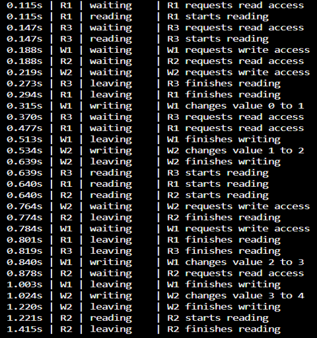
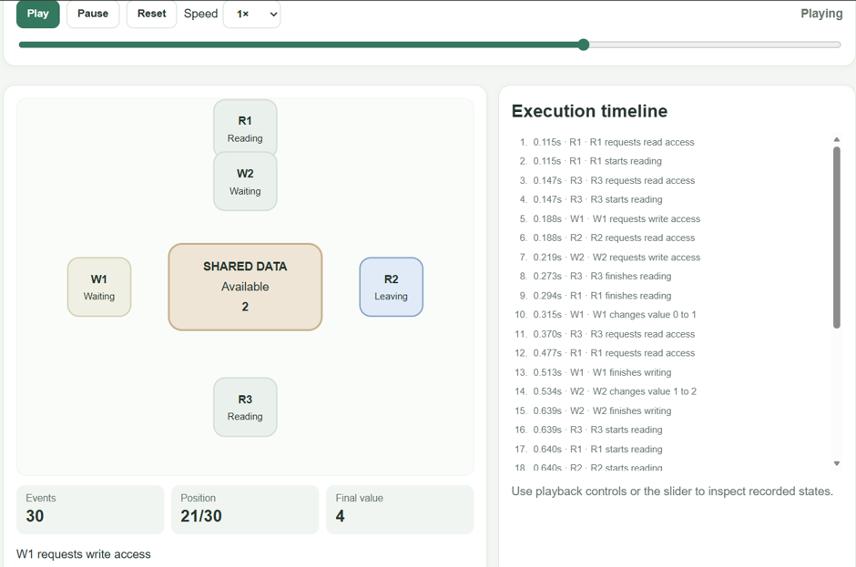
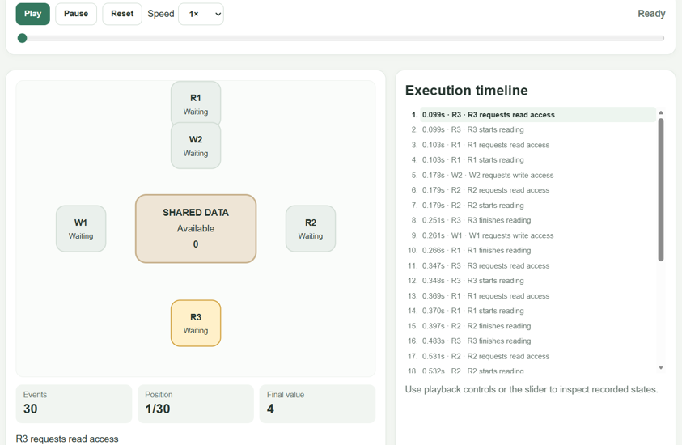
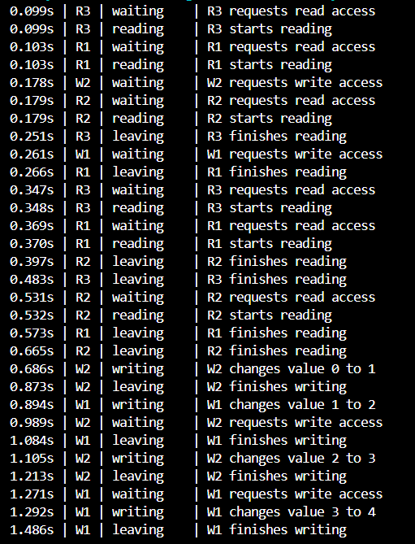
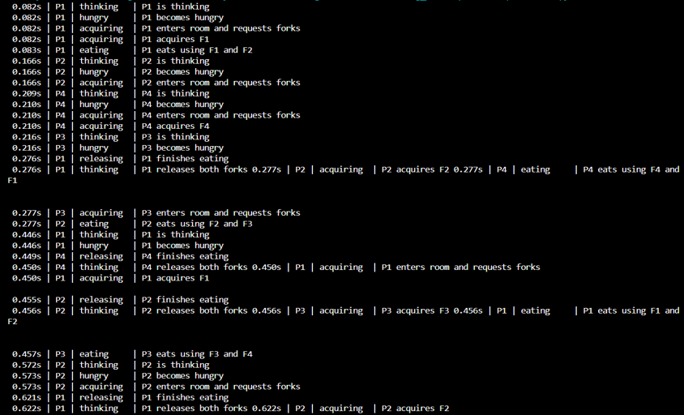
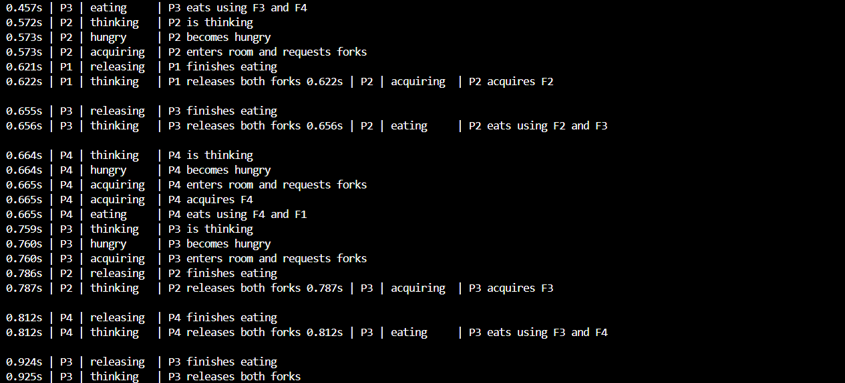
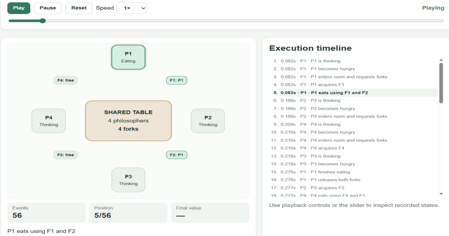
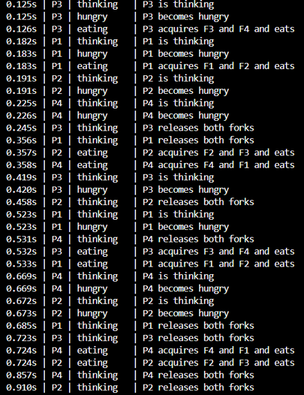
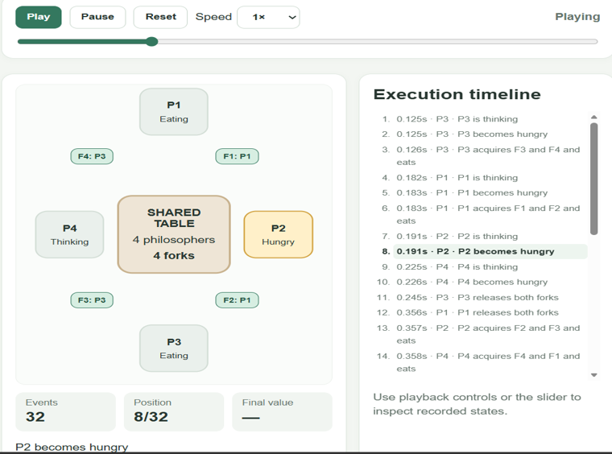

# OS Synchronization Assignment

Python implementations of the Readers–Writers and Dining Philosophers problems using semaphore-based and monitor-style synchronization. The programs record execution events and generate HTML pages that replay those recorded events.

## Implementations

- Readers–Writers using semaphores
- Readers–Writers using monitor-style synchronization (`threading.Condition`)
- Dining Philosophers using semaphores
- Dining Philosophers using monitor-style synchronization

## Screenshots

Screenshots of terminal output and HTML playback are stored in [`screenshots/`](screenshots/).

### Readers–Writers: Semaphore-Based

**Terminal output**



**HTML animation**



### Readers–Writers: Monitor-Based

**HTML animation**



**Terminal output**



### Dining Philosophers: Semaphore-Based

**Terminal output — Part 1**



**Terminal output — Part 2**



**HTML animation**



### Dining Philosophers: Monitor-Based

**Terminal output**



**HTML animation**



## Project Structure

```text
OS-Synchronization-Assignment/
├── README.md
├── screenshots/
│   ├── README.md
│   └── terminal and HTML animation screenshots
├── readers_writers/
├── dining_philosophers/
└── generated_html/
```

## Notes

- The HTML pages replay events recorded during a completed Python execution; they do not control live Python threads.
- Event ordering can vary between runs because of thread scheduling and delays.
- Run the relevant Python program again to generate a fresh event trace and HTML replay.
