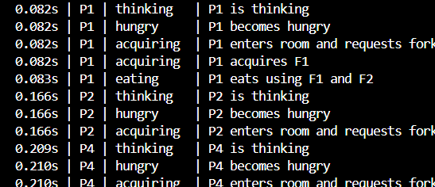
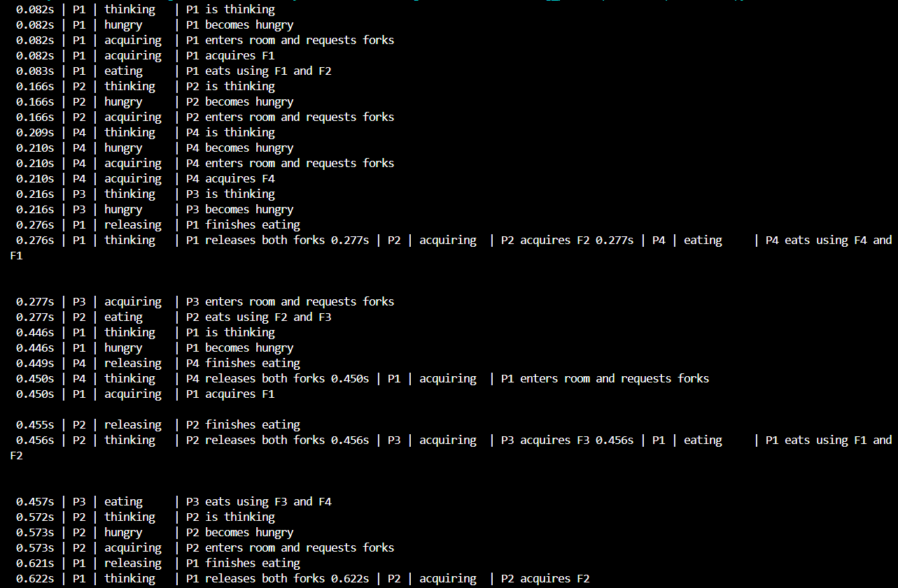
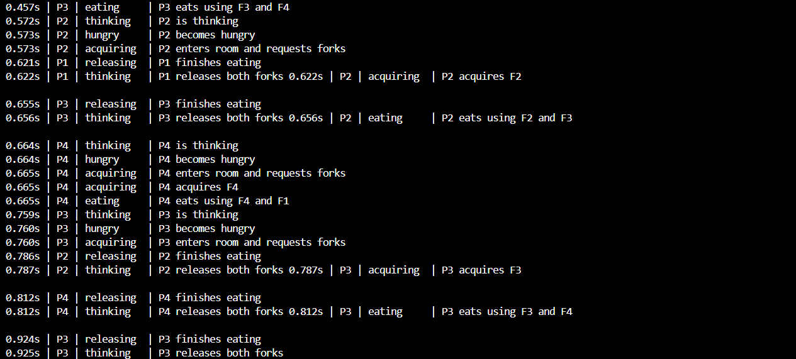
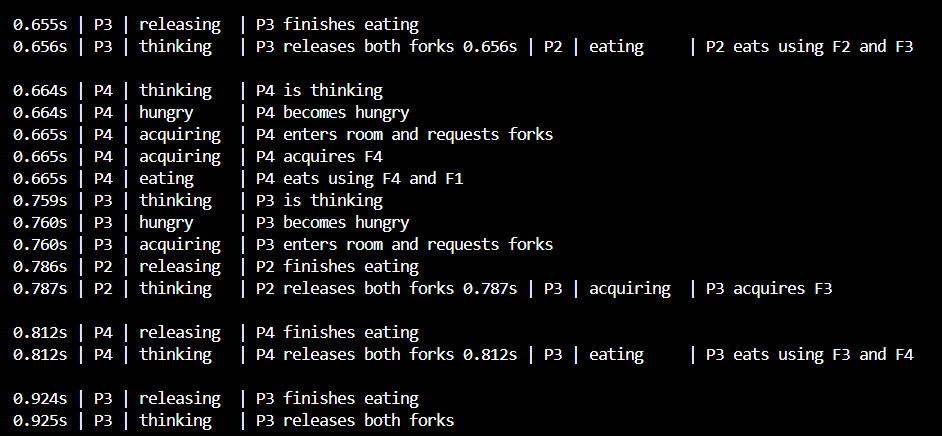

# OS Synchronization Assignment

This project demonstrates two classical operating-system synchronization problems in Python:

- **Readers–Writers**
- **Dining Philosophers**

Each problem has a semaphore-based solution and a monitor-style solution. The programs record execution events and generate HTML pages that replay those events so the thread states and resource usage can be inspected visually.

## Implementations

| Problem | Synchronization approach | HTML replay |
|---|---|---|
| Readers–Writers | Semaphores | `generated_html/readers_writers_semaphore.html` |
| Readers–Writers | Monitor-style (`threading.Condition`) | `generated_html/readers_writers_monitor.html` |
| Dining Philosophers | Semaphores | `generated_html/dining_philosophers_semaphore.html` |
| Dining Philosophers | Monitor-style | `generated_html/dining_philosophers_monitor.html` |

## Features

- Concurrent Python threads
- Synchronization using semaphores, locks, and condition variables
- Event recording with relative timestamps and actor states
- HTML playback with Play, Pause, Reset, speed, and timeline controls
- Recorded traces for reviewing each program run

## Running the project

Run each Python implementation from the project root using the file paths in the repository. After execution, open the corresponding generated HTML file in a web browser.

> The HTML pages replay events recorded during a completed Python run. They do not control the Python threads live. Event ordering may differ between runs because thread scheduling and delays can vary.

## Screenshots

Screenshots of terminal output and HTML replays are stored in the [`screenshots`](screenshots/) folder.

### Readers–Writers using semaphores

**Terminal output**

**HTML replay**

### Readers–Writers using monitor-style synchronization

**Terminal output**

**HTML replay**

### Dining Philosophers using semaphores

**Terminal output — first section**

**Terminal output — additional trace sections**

**HTML replay**

### Dining Philosophers using monitor-style synchronization

**Terminal output**

**HTML replay**

## Screenshot notes

The images show example runs captured during development. Since the programs use concurrent threads, timestamps and event ordering can vary across runs.
